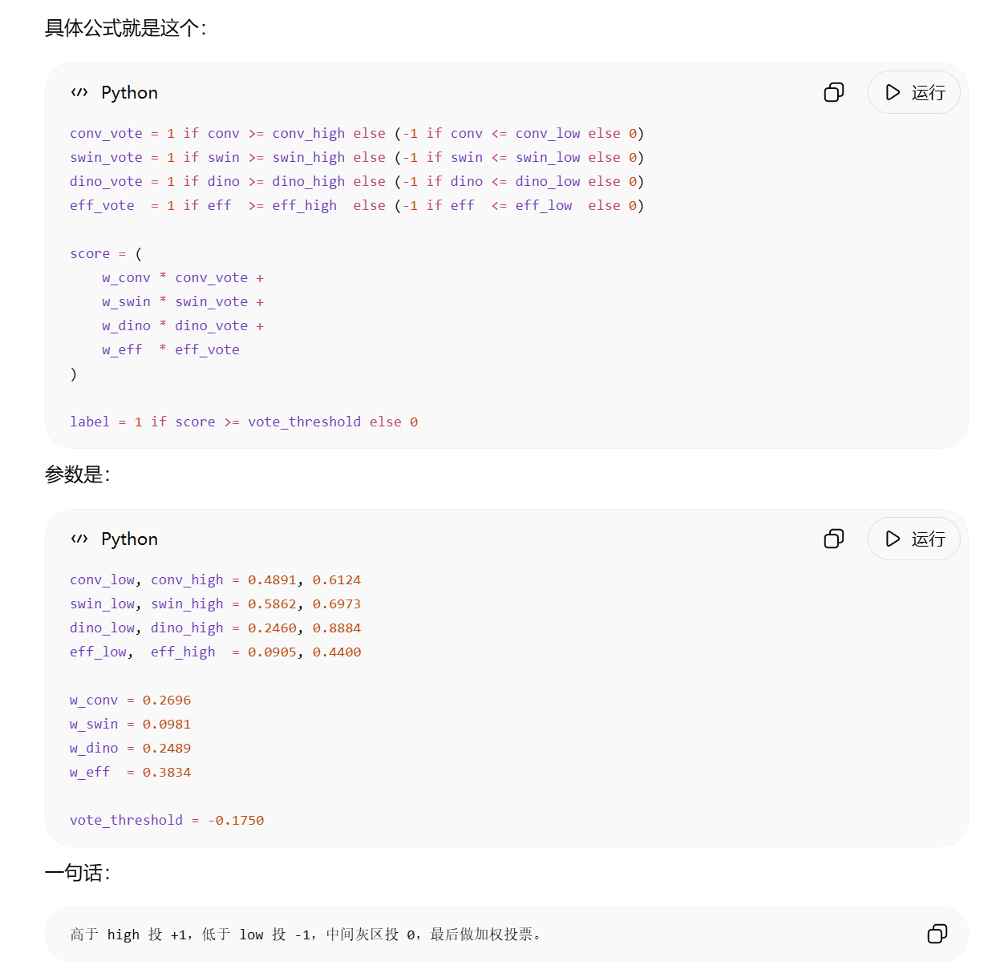

# Meteorite Vision: Classification, Domain Shift and Image Generation

An evidence-based portfolio of two connected computer-vision projects:

1. **Meteorite identification** under train/test domain shift, developed for a
   team Kaggle course competition.
2. **Meteorite image generation**, an individual DCGAN/WGAN-GP study evaluated
   with Fréchet Inception Distance (FID).

The repository focuses on reproducible code, experiment design and honest
failure analysis. Datasets, checkpoint binaries and personal course documents
are intentionally excluded. Metadata and a SHA-256 hash are retained only for
the DINOv2 checkpoint produced in the author's individual model branch.

Competition context: [Meteorite Identification](https://www.kaggle.com/competitions/meteorite-identification)
and [Meteorite Identification — Stage 2](https://www.kaggle.com/competitions/meteorite-identification-stage-2/data).


## Highlights

- Built the **ResNet-18 baseline** and complete training-to-submission workflow;
  achieved 0.9852 local F1 and 0.72222 Stage-1 online F1.
- Developed and ablated a **DINOv2 frozen-feature classifier**, including
  multi-layer CLS features, grouped validation, augmentation and test-time
  augmentation; best individual online F1: **0.73**.
- Collected and processed **100+ external meteorite images**, then used the
  negative result (0.73 → 0.71) to diagnose additional domain mismatch.
- Proposed **multi-model voting** after single-model improvements plateaued.
  A preserved confidence-interval configuration achieved **0.78260** public
  F1, while the team leaderboard records a final result of **0.78284**.
- Independently improved meteorite generation from DCGAN FID **245.92** to a
  final preserved WGAN-GP FID of **134.20**.

## Why this project matters

The main challenge was not model size but distribution shift. Training images
contained recurring rulers, color cards and controlled backgrounds, while test
images varied in lighting, viewpoint, scale and scene context. This created a
large gap between random-split validation and online performance.

The response was to improve the experimental process:

- group visually similar images during splitting to reduce near-duplicate
  leakage;
- test whether augmentation and external data actually transfer online;
- record failed experiments rather than selecting only positive results;
- combine diverse models when individual tuning reached diminishing returns.

## Repository structure

```text
meteorite-vision-portfolio/
├── assets/                         # Generated samples and ensemble evidence
├── classification/
│   ├── configs/                    # Recovered best-run configuration
│   ├── notebooks/                  # ResNet-18 baseline
│   ├── results/                    # Ablations, scores and DINOv2 checkpoint metadata
│   └── src/                        # Training, prediction and voting code
├── generation/
│   ├── notebooks/                  # DCGAN/WGAN-GP experiment sequence
│   └── results/                    # FID metrics and comparison table
└── docs/                            # Detailed history and evidence notes
```

## Classification approach

The DINOv2 pipeline freezes a pretrained backbone and trains a linear head on
the concatenated CLS tokens from the last two transformer blocks. It includes:

- average-hash grouping with `StratifiedGroupKFold`;
- random resized crop, horizontal/vertical flips and Gaussian blur;
- class-weighted cross-entropy, early stopping and checkpoint metadata;
- reusable prediction with test-time augmentation.

Expected data layout:

```text
data/
├── train_images/
├── test_images/
├── train_labels.csv       # columns: id, label
└── sample_submission.csv  # column: id
```

Example:

```bash
python classification/src/train_dinov2.py \
  --data_dir data \
  --model_name dinov2_vits14 \
  --concat_layers 2 \
  --epochs 30 \
  --batch_size 128 \
  --lr 0.003 \
  --weight_decay 0.01
```

DINOv2 is loaded through `torch.hub`, so the first run requires internet access.

## Confidence-interval voting

Each model converts its class-1 probability into a three-valued vote:

- probability at or above `high`: `+1`;
- probability at or below `low`: `-1`;
- probability in between: `0`, meaning abstention.

The ensemble calculates

```text
score = Σ(weight_model × vote_model)
prediction = 1 if score >= -0.1750 else 0
```

The preserved v2 configuration is:

| Model | Low | High | Weight |
|---|---:|---:|---:|
| ConvNeXt-Tiny | 0.4891 | 0.6124 | 0.2696 |
| Swin V2-S | 0.5862 | 0.6973 | 0.0981 |
| DINOv2 ViT-S/14 | 0.2460 | 0.8884 | 0.2489 |
| EfficientNetV2-S | 0.0905 | 0.4400 | 0.3834 |

The weights sum to 1.0. The configuration and a reconstructed inference
implementation are stored in
[`ensemble_v2_0.78260.json`](classification/configs/ensemble_v2_0.78260.json)
and [`ensemble_vote.py`](classification/src/ensemble_vote.py).



This exact parameter set is supported by a screenshot of the v2 submission,
which scored **0.78260**. A separate course leaderboard records **0.78284** as
the team's final score, but the final fitting script and its exact parameter set
were not retained. The repository keeps these two evidence records separate.
The preserved submission evidence is available
[here](assets/ensemble_v2_public_score.png).

## Generation study

The notebooks preserve the actual experiment path instead of presenting a
single cleaned-up run:

| Experiment | FID | Decision |
|---|---:|---|
| DCGAN baseline | 245.9168 | Replace unstable objective |
| WGAN-GP v1 | 189.7166 | Keep gradient penalty |
| Capacity-balanced v2 | 170.82 | Continue architecture tuning |
| SpectralNorm v3 | 137.25 | Best reported comparison run |
| Final saved evaluation | **134.203409** | 1,000 generated / 2,682 real images |
| EMA + larger v4 | 400+ | Reject regression |

See [the experiment log](docs/experiment_log.md) for provenance and limitations.

## Contribution and attribution

**Individual work represented here:** ResNet-18 baseline, DINOv2 training and
ablations, external-image collection/processing, the voting-ensemble proposal,
and the complete generative-model study.

**Team work:** the final four-model voting implementation and competition
submission. The original team repository is available at
[meteorite-identification-stage2](https://github.com/enhhhj/meteorite-identification-stage2/).

No claim is made that every team model or the final ensemble implementation was
created individually.

## Reproducibility and data policy

Install the Python dependencies with `pip install -r requirements.txt`. The
repository excludes competition data, scraped images, checkpoint binaries,
course archives and reports containing personal information. Only the
author's **DINOv2 checkpoint** is treated as a personal model artifact. Its
84.22 MiB size and SHA-256 are preserved in
[`checkpoint_manifest.csv`](classification/results/checkpoint_manifest.csv).
The ConvNeXt, EfficientNet and Swin checkpoints belong to other team branches
and are not listed or redistributed here. The author's DINOv2 checkpoint is
distributed separately in the
[`v1.0-model` GitHub Release](https://github.com/0zz0ruby/meteorite-vision-portfolio/releases/tag/v1.0-model),
so the source repository remains light. Verify the downloaded file against the
SHA-256 in the checkpoint manifest. Reproduction also requires obtaining the
competition data separately.

For the full Chinese project narrative, see
[docs/project_history_zh.md](docs/project_history_zh.md).
